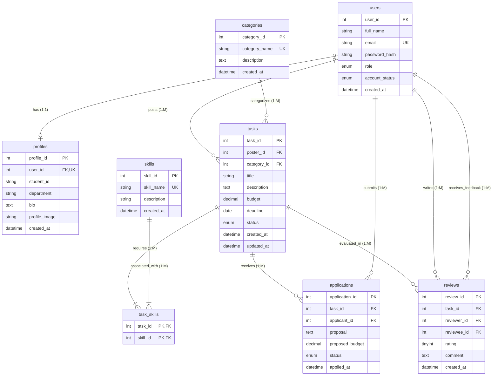

# Entity-Relationship (ER) Diagram & Relational Schema
**Course:** CSE 2291 — Database Management System (DBMS)  
**Project:** CampusTask (A University-Based Student Freelance Task Marketplace)  
**Author:** Person A (Task Side)

---

## 1. Visual Entity-Relationship (ER) Diagram

The diagram below illustrates the 8 normalized core entities, their primary keys (PK), foreign keys (FK), and relationship cardinalities using Mermaid ER syntax:

---

## 2. Cardinality & Relationship Breakdown

| Relationship | Type | Cardinality | Explanation |
|---|---|---|---|
| **Users to Profiles** | One-to-One (1:1) | Optional to Mandatory (1 : 0..1) | Each registered student has at most one profile row (`user_id` is UNIQUE FK in `profiles`). Created on first profile save. |
| **Users to Tasks (Poster)** | One-to-Many (1:M) | Mandatory to Optional (1 : 0..N) | A student user can post 0 or many tasks. Every task must be posted by exactly one user (`poster_id`). |
| **Categories to Tasks** | One-to-Many (1:M) | Mandatory to Optional (1 : 0..N) | Each category classifies multiple tasks. Each task belongs to exactly one category (`category_id` FK). |
| **Tasks to Skills (via `task_skills`)** | Many-to-Many (M:N) | Many-to-Many (M : N) | A task can require multiple skills, and a skill can be tagged on multiple tasks. Resolved by the composite junction table `task_skills`. |
| **Tasks to Applications** | One-to-Many (1:M) | Mandatory to Optional (1 : 0..N) | A task can receive zero or multiple student proposals. Each application belongs to exactly one task. |
| **Users to Applications (Applicant)** | One-to-Many (1:M) | Mandatory to Optional (1 : 0..N) | A student can apply to multiple tasks. One application is submitted by exactly one student (`applicant_id`). |
| **Tasks to Reviews** | One-to-Many (1:M) | Mandatory to Optional (1 : 0..2) | Once a task reaches `COMPLETED`, up to two reviews (poster $\leftrightarrow$ accepted freelancer) can be submitted. |
| **Users to Reviews (Reviewer & Reviewee)** | One-to-Many (1:M) Twice | Mandatory to Optional (1 : 0..N) | `users` is referenced twice in `reviews`: once as the author (`reviewer_id`), and once as the recipient of the rating (`reviewee_id`). |

---

## 3. Referential Integrity & Foreign Key Actions

1. **Cascade Delete for Dependent Records (`ON DELETE CASCADE`):**
   - When a user is removed, their `profiles`, posted `tasks`, `applications`, and `reviews` are automatically removed to prevent orphaned data.
   - When a task is deleted (only allowed while `OPEN`), its corresponding entries in `task_skills` and any pending `applications` are cascaded.
2. **Restrict Category Deletion (`ON DELETE RESTRICT`):**
   - A category cannot be deleted if active tasks are currently assigned to it. The administrator is prompted with a friendly warning.
3. **Database Unique Constraints:**
   - `users.email`: Unique university email prevents duplicate registrations.
   - `applications (task_id, applicant_id)`: Enforces business rule that a student cannot submit duplicate proposals on the same task.
   - `reviews (task_id, reviewer_id)`: Guarantees that each party can only submit one review per completed task.
